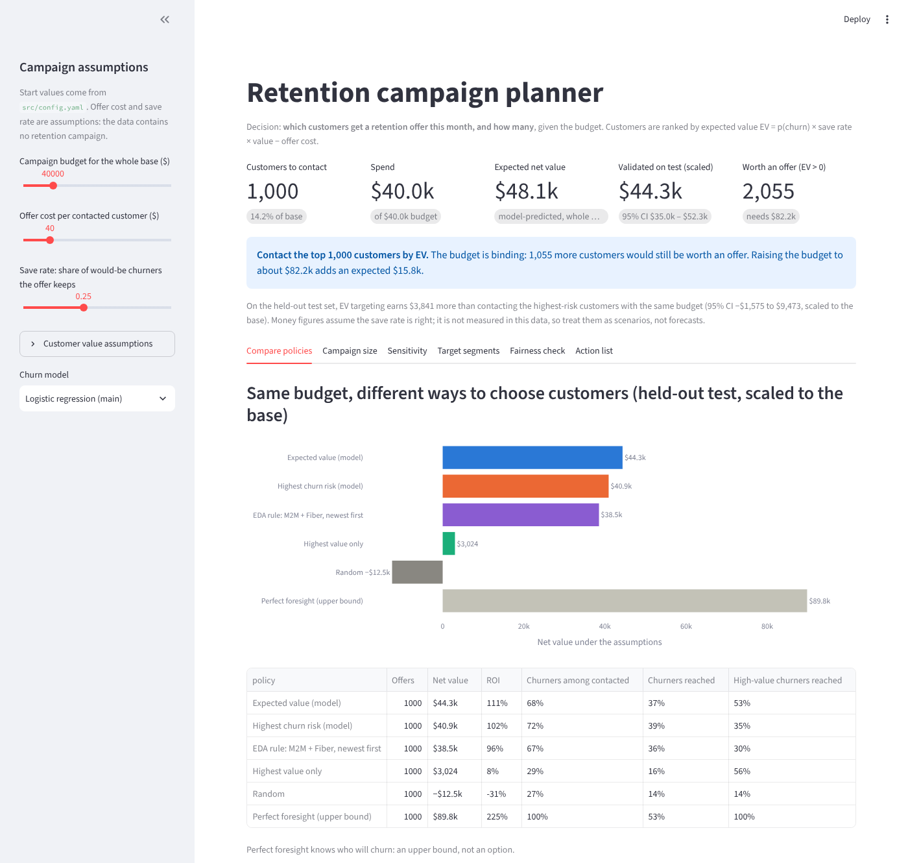

# Profit-Aware Telecom Churn & Retention Targeting

BA-HUST Capstone 2026, topic 7.

**Business question.** Given a limited retention budget, which customers should receive an offer when both churn risk and
expected economic value are considered?

**Answer in one paragraph.** Rank customers by expected value, `EV = p(churn) × save rate × value − offer cost`, and contact
them in that order while EV > 0 and budget remains. Under the base-case assumptions (offer $40, save rate 25%, margin 50%,
12-month horizon), a $40k campaign reaches 1,000 customers and is worth about **$44k net (95% CI $35k–$52k)** on held-out data,
slightly more than targeting the highest-risk customers ($41k) and reaching **53% of high-value churners instead of 35%**.
About 2,060 customers are worth an offer, so a budget of roughly $82k would be worth about $55k. Whether the campaign pays at
all depends on the save rate and offer cost, which this data cannot measure. A randomized pilot should come first.
Details: [`docs/executive_brief.md`](docs/executive_brief.md).



---

## 1. Problem definition

| | |
|---|---|
| Business decision | Which customers receive a retention offer in this month's campaign, and how many, under a fixed budget |
| Unit of analysis | One customer account (`customerID`), 7,043 customers |
| Target / outcome | `Churn = Yes`: the customer left within the last month (IBM data description). Base rate 26.5% |
| Evaluation period | One monthly churn window. The data is a single snapshot without dates, so there is no later period to validate on |
| Decision time | Start of the month, before churn. Predictors are account attributes (contract, services, billing, tenure, charges) |
| Technical metrics | ROC-AUC, PR-AUC, log loss, Brier score, expected calibration error, calibration slope (with bootstrap CIs) |
| Business metrics | Net retention value under stated assumptions, ROI, precision among contacted, recall of churners, coverage of high-value churners |

## 2. Data

| | |
|---|---|
| Dataset | IBM Telco Customer Churn sample data (fictional telco, built by IBM for teaching) |
| Source used | Kaggle mirror: <https://www.kaggle.com/datasets/blastchar/telco-customer-churn>, file `WA_Fn-UseC_-Telco-Customer-Churn.csv` |
| Original publisher | IBM sample data sets (IBM Cognos Analytics / Watson Analytics samples) |
| File in repo | `data/WA_Fn-UseC_-Telco-Customer-Churn.csv`, 7,043 rows × 21 columns, SHA-256 `16320c9c…3055e91` |
| Download date | File committed on **2026-10-24** (commit `41dfa42`). *Team: replace with the exact Kaggle download date if it differs.* |
| License / terms | The Kaggle page does not show an open license (an IBM Community thread asking about the license has no official answer). The scikit-learn Hugging Face mirror of the same data lists CC BY 4.0. We use it for non-commercial teaching only, with attribution to IBM. *Team: record the license field shown on the Kaggle page at download.* |
| Filtering / joining | None. No rows removed, no external data joined. 11 blank `TotalCharges` (all `tenure = 0`) set to 0. 22 duplicate feature rows kept (different customers). See [`docs/eda_to_preprocessing.md`](docs/eda_to_preprocessing.md) |
| Synthetic additions | None in the data. Offer cost, save rate, margin, horizon and budget are **assumptions** set in [`src/config.yaml`](src/config.yaml) (`business`, `sensitivity`, `segment_offers`) |

**Leakage.** The Kaggle file has no post-outcome columns. The IBM extended release's `Churn Reason`, `Churn Score` and `CLTV`
are absent (asserted in notebook 03). No model uses `customerID`, the label or `gender`. `tenure` and `TotalCharges` are
recorded at the snapshot and so include the churn month for churners. That is a small, uniform shift, not an outcome leak,
and it is listed as a limitation.

**Validation design.** No timestamps, so a temporal split is impossible. We use a stratified 60/20/20 train/val/test split
(fixed in `data/processed/splits.csv`, seed 42):

- **train** is for model fitting and 5-fold CV tuning.
- **val** is for calibration, model choice by campaign value, and choosing the campaign size.
- **test** is used once, in notebook 04 section 5, for every final number.

The lack of a temporal holdout is a stated limitation.

## 3. Repository

```
data/                       raw CSV + data/processed/ (clean table, split assignment)
notebooks/
  01_eda.ipynb              EDA, risk/value segments                       → eda_output/
  02_preprocessing.ipynb    cleaning, features, splits, linearity checks   → data/processed/, eda_output/figures/p0*
  03_modeling.ipynb         LR, random forest, LightGBM; calibration;
                            threshold analysis (val only)                  → model_output/
  04_targeting.ipynb        value proxy, EV targeting vs simple rules, test evaluation, sensitivity,
                            segments, fairness, scorecard, SHAP, targeting table → targeting_output/
src/
  config.yaml               every parameter and business assumption (one place)
  preprocessing.py  modeling.py  value.py  targeting.py  scorecard.py
dashboard/app.py            Streamlit decision dashboard
docs/
  executive_brief.md        recommendation, impact range, risks, limitations (plain language)
  retention_playbook.md     campaign size, offers, EV logic, operating steps, guardrails, pilot design
  eda_to_preprocessing.md   why each preprocessing decision was made (Vietnamese)
main.py                     reruns the whole analysis
```

Key outputs:

- `targeting_output/tables/customer_targeting_table.csv`: every customer with p_churn, value, EV, priority rank, contact
  flag, top-3 churn reasons and suggested offer.
- `targeting_output/tables/churn_scorecard.csv`: LR as a points scorecard.
- `targeting_output/targeting_report.xlsx`: assumptions, targeting table, scorecard, metrics, policy comparison,
  sensitivity, segments and fairness, one sheet each.
- `targeting_output/tables/summary.json`: the headline numbers quoted in the docs.

## 4. How to rerun

Requires Python ≥ 3.12.

```bash
pip install -r requirements.txt          # or: uv pip install -r requirements.txt
python main.py --skip-training           # 01 → 02 → 04 with the committed models (~1 min): reproduces the numbers in docs/
python main.py                           # full rerun including model tuning in notebook 03 (~6 min on 2 cores)
streamlit run dashboard/app.py           # dashboard at http://localhost:8501
```

`python main.py` executes the notebooks in place, so their saved outputs are refreshed. Retraining (notebook 03) with
different library versions can shift results slightly. `--skip-training` reproduces the documented numbers exactly.
To change an assumption, edit `src/config.yaml` and rerun step 04 (`python main.py --only 04`), or move the dashboard sliders.

## 5. Results (test set, base-case assumptions)

| | Logistic regression (main) | Random forest | LightGBM |
|---|---|---|---|
| ROC-AUC | 0.848 | 0.843 | 0.846 |
| PR-AUC | 0.666 | 0.652 | 0.670 |
| ECE / calibration slope | 0.022 / 0.96 | 0.011 / 1.08 | 0.024 / 0.98 |

The three models are statistically tied (paired bootstrap). LR was chosen on val by campaign value and interpretability,
before test was opened.

| Policy, 1,000 offers / $40k for the base | Net value (≈ base) | 95% CI | Precision | High-value churners reached |
|---|---|---|---|---|
| **Expected value (LR + value)** | **$44.3k** | $35.2k – $52.4k | 68.5% | 53% |
| Highest churn risk (LR) | $40.9k | $32.5k – $47.3k | 72.5% | 35% |
| EDA rule: month-to-month + fiber, newest first | $38.5k | $31.2k – $46.6k | 67.0% | 30% |
| Highest value only | $3.0k | −$7.3k – $12.0k | 29.0% | 56% |
| Random | −$12.5k | −$15.2k – −$10.0k | 26.5% | 14% |

Test covers 1,409 customers; figures × 7,043/1,409. Net value = Σ over contacted (churned × save rate × V − offer cost).
This is a scenario under the stated save rate, not a measured campaign effect.

Sensitivity, the uncertainty ranges and the segment and fairness analysis are in notebook 04 and the dashboard.

## 6. Final submission checklist

| Checklist item | Where |
|---|---|
| Decision, unit of analysis, target, evaluation period defined | §1 above; notebook 04 header; executive brief |
| Data source, download date, license/terms, filtering/joining documented | §2 above (two fields for the team to confirm) |
| No target leakage; predictors available at decision time | §2 "Leakage"; notebook 03 §1 checks; notebook 04 §0 |
| Baseline complete and compared fairly | Notebook 03: LR + RF + LightGBM, same splits, same CV, same tuning metric; notebook 04 §3, §5 |
| Validation matches the problem's structure | §2 "Validation design"; no timestamps, so stratified split with val/test separation; limitation stated |
| Technical and business metrics reported | §5; notebook 03 §5–6; notebook 04 §5 |
| Scenario assumptions visible, sensitivity included | `src/config.yaml` `business` / `sensitivity`; notebook 04 §6; dashboard sliders and Sensitivity tab |
| Dashboard supports a concrete decision | `dashboard/app.py`: how many and which customers to contact at a given budget and set of assumptions; downloadable action list |
| Executive brief: recommendation, impact range, risks, limitations | [`docs/executive_brief.md`](docs/executive_brief.md) |
| Third party can rerun from README and code | §4: `pip install -r requirements.txt && python main.py` |

## 7. Scope guardrails

- **No causal or uplift claims.** The data contains no randomized retention campaign. The save rate is an assumption, and
  every value is "expected value if the offer saves this share of churners". The playbook proposes the randomized pilot that
  would measure it.
- **External validity.** IBM's sample telco is fictional, a single snapshot, with a 26.5% monthly churn rate far above real
  telcos. The method transfers; the numbers do not.
- **Visible assumptions.** Every assumption is a parameter in `src/config.yaml` and a dashboard slider. Nothing is a hidden
  constant.
